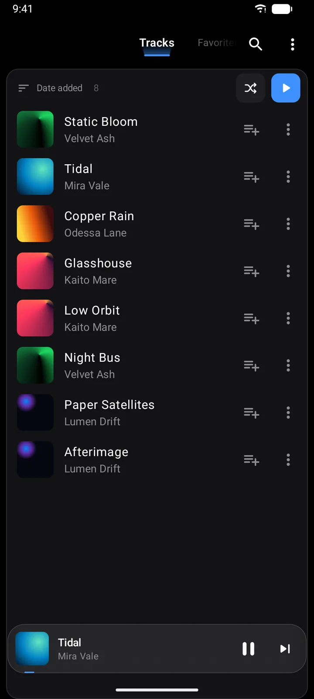
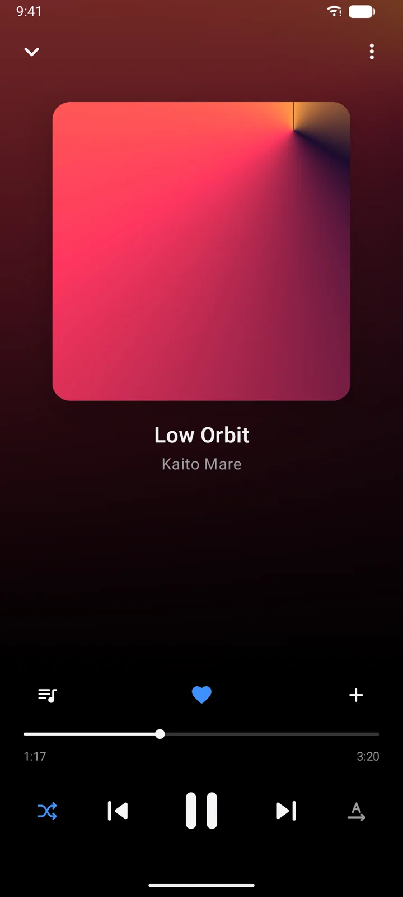
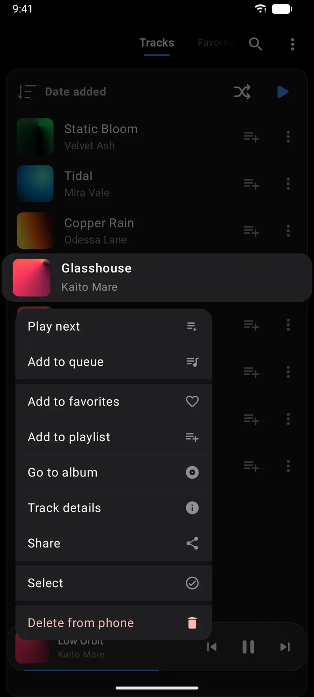
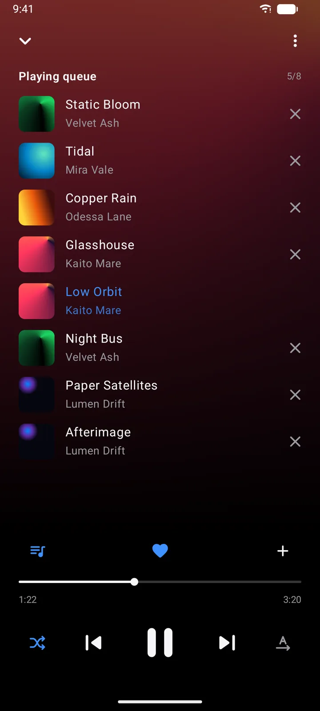
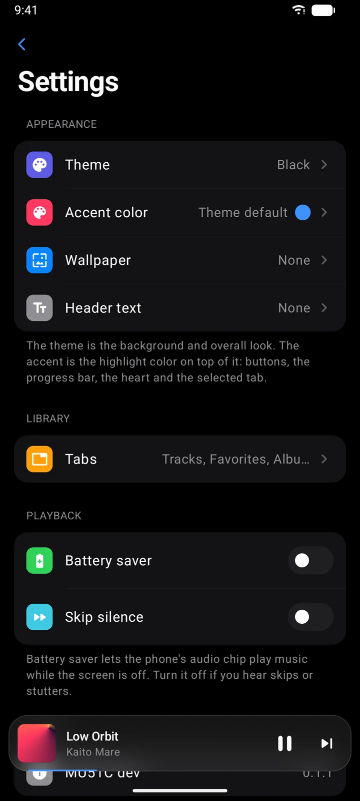
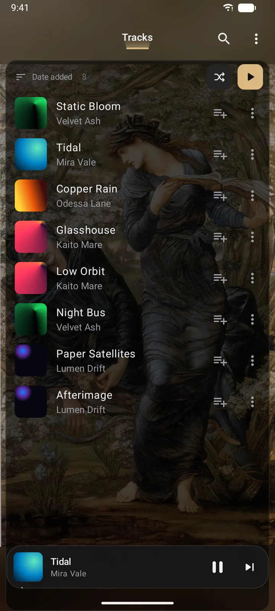

# MU51C

**An offline music player for Android.** It plays the music already on your phone, with no account, no
internet permission and no tracking.

It started as a personal replacement for the stock player on a Galaxy phone, built to use almost no battery and
to look like its own thing: themes on true black (or white), a player you drag up with your finger, a home
screen widget, and play counts kept on the device.

`Kotlin · Jetpack Compose · Material 3` · `AndroidX Media3 (ExoPlayer + MediaSession)` · `Room · DataStore` ·
`Coil 3 · Haze` · `GitHub Actions release`

<p align="center">
  
  
  
</p>

---

## What it does

- **Library** of tracks, albums, artists, folders, playlists, favorites, most played and recently played. Pick
  the tabs you want, in your order, and swipe between them.
- **Swipe-up player**: the glass bar at the bottom follows your finger up into the full player and back down.
  The queue opens in place of the artwork.
- **Hold gestures**: hold play to hear the track up to three more times; hold next or back to skip through it.
- **Track menus**: a long press lifts the track and opens a quick menu; the ⋯ button opens the full one, with
  track details and a search on Google or YouTube.
- **Pick several tracks** to play, add to a playlist, share or delete them at once.
- **Themes**: Blue, Black, Green, White, or colors taken from your own wallpaper, with an accent color on top.
- **Long-press hints**: hold any icon button to see what it does or which mode it's in.
- **Home screen widget** with the cover, the song and play controls.
- **Battery first**: nothing runs in the background unless music is playing, and the widget never polls.

## Screens

<p align="center">
  
  
  
</p>

<sub>Wallpaper in the last screenshot: Edward Burne-Jones, <i>The Beguiling of Merlin</i> (1874), public domain,
via Wikimedia Commons. The tracks are generated demo files.</sub>

---

## Project structure

```
app/src/main/java/com/suna/player/
├── MainActivity.kt      app shell and navigation
├── SunaApp.kt           app-wide stores
├── data/                media library, Room database, settings
├── playback/            playback service, queue, media session
├── widget/              home screen widget
└── ui/
    ├── library/         tabs, song lists, menus, song details
    ├── player/          mini bar, full player, queue
    ├── settings/        settings pages, wallpaper editor
    ├── common/          shared rows, selection, actions
    └── theme/           themes, accents, wallpaper colors
```

## Tech stack

| | |
|---|---|
| Language | Kotlin 2.4 |
| UI | Jetpack Compose, Material 3 |
| Playback | AndroidX Media3 1.11: ExoPlayer, MediaSessionService |
| Storage | Room 2.8 (playlists, favorites, play counts), DataStore (settings) |
| Images | Coil 3; Haze for the frosted-glass player bar |
| Build | Gradle 9.6, Android Gradle Plugin 9.5, KSP |
| Android | min SDK 33 (Android 13), target SDK 36 |
| CI | GitHub Actions builds a signed APK and publishes it as a release |

## Build it

Open the project in Android Studio, or from a terminal:

```bash
./gradlew assembleDebug
```

The debug build installs next to the release one as *MU51C dev*. Release APKs are built by the
*Release APK* workflow on the Actions tab.

## Permissions

| Permission | Why |
|---|---|
| Read audio files | to find the music on the phone |
| Notifications | the playback controls in the notification shade |
| Foreground service | to keep playing with the screen off |

There is no internet permission. *Search online* hands the song's name to Google or YouTube, which open on
their own.
